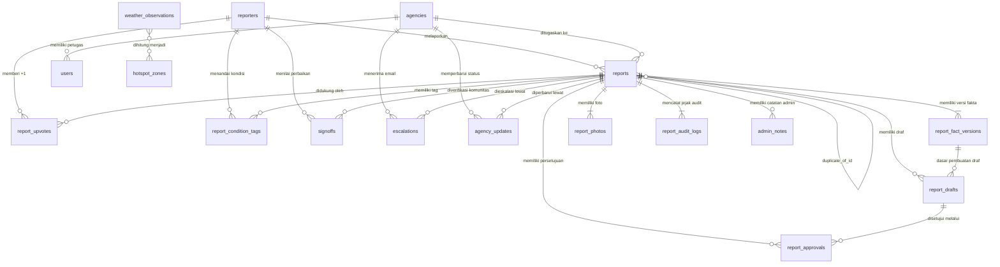

# **DATABASE SCHEMA SPECIFICATION**

**SIJAGO (Sistem Jalan Bogor)** — Dokumentasi Skema Basis Data Relasional & Geospasial

| Atribut | Keterangan |
| :---- | :---- |
| **Versi dokumen** | 1.0 (Selaras dengan PRD v1.0 & BRD v1.0) |
| **Tanggal** | 25 Oktober 2026 |
| **Pemilik dokumen** | **Boby** (System Architect & Fullstack Developer) & **Sabira** (PM & UI/UX Designer) |
| **DBMS & Hosting** | **Neon PostgreSQL (Free Tier)** dengan ekstensi `postgis` dan `pgcrypto` |
| **ORM & Migrasi** | **Drizzle ORM** (`drizzle-orm/pg-core`) + `drizzle-kit` |

---

## **1. Ikhtisar Arsitektur Database**

Basis data SIJAGO dirancang untuk menegakkan **empat prinsip kritis** langsung di tingkat database:
1. **Validasi Geospasial (PostGIS):** Menyimpan titik koordinat laporan (`geometry(Point, 4326)`) dan poligon batas administratif Kota Bogor serta zona merah curah hujan (`geometry(Polygon, 4326)`).
2. **Integritas Human-in-the-Loop (`facts_hash`):** Memisahkan tabel laporan utama (`reports`), riwayat versi fakta (`report_fact_versions`), draf AI/Template (`report_drafts`), dan persetujuan warga (`report_approvals`).
3. **Auditabilitas Mutlak (*Append-Only Log*):** Tabel `report_audit_logs` dilindungi oleh *Database Trigger* yang menolak operasi `UPDATE` dan `DELETE`, serta dilengkapi *Hash Chain* (`prev_entry_hash` -> `entry_hash`).
4. **Privasi & Minimisasi PII:** Identitas pelapor dipisahkan ke tabel `reporters` secara pseudonim sehingga penghapusan email kontak (hak subjek data UU PDP) tidak merusak keutuhan laporan maupun audit log.

---

## **2. Entity-Relationship Diagram (ERD)**



---

## **3. Prasyarat Ekstensi & Enum PostgreSQL**

Sebelum menjalankan migrasi tabel, migrasi awal (`0000_init_extensions.sql`) wajib mengaktifkan ekstensi dan tipe `ENUM` berikut:

```sql
-- Ekstensi wajib di Neon PostgreSQL
CREATE EXTENSION IF NOT EXISTS "pgcrypto";
CREATE EXTENSION IF NOT EXISTS "postgis";

-- Enum Status Laporan (PRD Bagian 6)
CREATE TYPE report_status AS ENUM (
  'DRAFT',
  'MENUNGGU_VERIFIKASI',
  'TERVERIFIKASI',
  'DITOLAK',
  'DUPLIKAT',
  'DITERUSKAN',
  'DIPROSES',
  'SELESAI',
  'DIBUKA_KEMBALI',
  'DITUTUP'
);

-- Enum Kategori Kerusakan Jalan (FR-1.6)
CREATE TYPE damage_category AS ENUM (
  'LUBANG',
  'RETAK',
  'AMBLAS',
  'BERGELOMBANG',
  'GENANGAN_DRAINASE',
  'LAINNYA'
);

-- Enum Kelas Ukuran Kerusakan (FR-1.6)
CREATE TYPE damage_size_class AS ENUM (
  'KECIL',
  'SEDANG',
  'BESAR'
);

-- Enum Sumber Titik Lokasi (FR-1.3, FR-1.5)
CREATE TYPE location_source AS ENUM (
  'GPS',
  'MANUAL_PIN'
);

-- Enum Sumber Draf (FR-2.7)
CREATE TYPE draft_source_type AS ENUM (
  'AI',
  'TEMPLATE'
);

-- Enum Alasan Fallback AI (FR-2.4, FR-2.5)
CREATE TYPE ai_fallback_reason AS ENUM (
  'TIMEOUT',
  'API_ERROR',
  'VALIDATION_FAILED',
  'QUOTA_EXCEEDED',
  'DISABLED'
);

-- Enum Jenis Foto (PRD Bagian 8.2)
CREATE TYPE photo_kind AS ENUM (
  'REPORT',
  'BEFORE',
  'AFTER',
  'SIGNOFF'
);

-- Enum Peran Pengguna Internal & Mitra
CREATE TYPE user_role AS ENUM (
  'ADMIN',
  'AUDITOR',
  'SUPER_ADMIN',
  'PETUGAS_INSTANSI'
);

-- Enum Level Kewenangan Instansi
CREATE TYPE agency_level AS ENUM (
  'KOTA',
  'PROVINSI',
  'NASIONAL'
);

-- Enum Status Pengiriman Email Resend (FR-5.7, FR-5.8)
CREATE TYPE email_delivery_status AS ENUM (
  'QUEUED',
  'SENT',
  'DELIVERED',
  'BOUNCED',
  'FAILED'
);

-- Enum Tipe Aktor Audit Log (FR-7.2)
CREATE TYPE audit_actor_type AS ENUM (
  'WARGA_PSEUDONIM',
  'ADMIN',
  'INSTANSI',
  'SISTEM',
  'AI'
);

-- Enum Tipe Aksi Audit Log Wajib (FR-7.3)
CREATE TYPE audit_action_type AS ENUM (
  'AI_GENERATE_SUCCESS',
  'AI_FALLBACK_TEMPLATE',
  'SOURCE_FACTS_MODIFIED',
  'APPROVAL_GRANTED',
  'APPROVAL_RESET',
  'REPORT_SUBMITTED',
  'VERIFY_REPORT',
  'REJECT_REPORT',
  'ROUTE_ASSIGNED',
  'ESCALATION_EMAIL_SENT',
  'ESCALATION_EMAIL_FAILED',
  'STATUS_CHANGED',
  'DUPLICATE_MERGED',
  'SIGNOFF_SUBMITTED',
  'REOPENED',
  'ADMIN_OVERRIDE',
  'LOG_EXPORTED',
  'CONFIG_UPDATED'
);

-- Enum Rating Community Sign-Off (FR-10.2)
CREATE TYPE signoff_rating AS ENUM (
  'MULUS',
  'CEPAT_RUSAK'
);
```

---

## **4. Implementasi Skema Drizzle ORM (`src/db/schema.ts`)**

Berikut adalah kode lengkap skema Drizzle ORM yang siap digunakan pada repositori **`sijago-backend`**:

```typescript
import {
  pgTable,
  pgEnum,
  uuid,
  varchar,
  text,
  integer,
  numeric,
  boolean,
  timestamp,
  date,
  jsonb,
  bigserial,
  uniqueIndex,
  index,
  customType,
} from "drizzle-orm/pg-core";

// ============================================================================
// 1. CUSTOM POSTGIS GEOMETRY TYPES
// ============================================================================
export const geometryPoint = customType<{ data: { lng: number; lat: number }; driverData: string }>({
  dataType() {
    return "geometry(Point, 4326)";
  },
  toDriver(value) {
    return `SRID=4326;POINT(${value.lng} ${value.lat})`;
  },
  fromDriver(value) {
    // Dikembalikan sebagai WKT/EWKB atau diparse via ST_AsGeoJSON di query
    return value as unknown as { lng: number; lat: number };
  },
});

export const geometryPolygon = customType<{ data: string; driverData: string }>({
  dataType() {
    return "geometry(MultiPolygon, 4326)";
  },
});

// ============================================================================
// 2. ENUMS
// ============================================================================
export const reportStatusEnum = pgEnum("report_status", [
  "DRAFT",
  "MENUNGGU_VERIFIKASI",
  "TERVERIFIKASI",
  "DITOLAK",
  "DUPLIKAT",
  "DITERUSKAN",
  "DIPROSES",
  "SELESAI",
  "DIBUKA_KEMBALI",
  "DITUTUP",
]);

export const damageCategoryEnum = pgEnum("damage_category", [
  "LUBANG",
  "RETAK",
  "AMBLAS",
  "BERGELOMBANG",
  "GENANGAN_DRAINASE",
  "LAINNYA",
]);

export const damageSizeClassEnum = pgEnum("damage_size_class", ["KECIL", "SEDANG", "BESAR"]);
export const locationSourceEnum = pgEnum("location_source", ["GPS", "MANUAL_PIN"]);
export const draftSourceTypeEnum = pgEnum("draft_source_type", ["AI", "TEMPLATE"]);
export const aiFallbackReasonEnum = pgEnum("ai_fallback_reason", [
  "TIMEOUT",
  "API_ERROR",
  "VALIDATION_FAILED",
  "QUOTA_EXCEEDED",
  "DISABLED",
]);
export const photoKindEnum = pgEnum("photo_kind", ["REPORT", "BEFORE", "AFTER", "SIGNOFF"]);
export const userRoleEnum = pgEnum("user_role", ["ADMIN", "AUDITOR", "SUPER_ADMIN", "PETUGAS_INSTANSI"]);
export const agencyLevelEnum = pgEnum("agency_level", ["KOTA", "PROVINSI", "NASIONAL"]);
export const emailDeliveryStatusEnum = pgEnum("email_delivery_status", [
  "QUEUED",
  "SENT",
  "DELIVERED",
  "BOUNCED",
  "FAILED",
]);
export const auditActorTypeEnum = pgEnum("audit_actor_type", [
  "WARGA_PSEUDONIM",
  "ADMIN",
  "INSTANSI",
  "SISTEM",
  "AI",
]);
export const auditActionTypeEnum = pgEnum("audit_action_type", [
  "AI_GENERATE_SUCCESS",
  "AI_FALLBACK_TEMPLATE",
  "SOURCE_FACTS_MODIFIED",
  "APPROVAL_GRANTED",
  "APPROVAL_RESET",
  "REPORT_SUBMITTED",
  "VERIFY_REPORT",
  "REJECT_REPORT",
  "ROUTE_ASSIGNED",
  "ESCALATION_EMAIL_SENT",
  "ESCALATION_EMAIL_FAILED",
  "STATUS_CHANGED",
  "DUPLICATE_MERGED",
  "SIGNOFF_SUBMITTED",
  "REOPENED",
  "ADMIN_OVERRIDE",
  "LOG_EXPORTED",
  "CONFIG_UPDATED",
]);
export const signoffRatingEnum = pgEnum("signoff_rating", ["MULUS", "CEPAT_RUSAK"]);

// ============================================================================
// 3. TABEL MASTER & PENGGUNA (REPORTERS, AGENCIES, USERS)
// ============================================================================

/**
 * Tabel identitas pseudonim pelapor/warga.
 * PII (contact_email) disimpan opsional & terpisah dari audit log.
 */
export const reporters = pgTable(
  "reporters",
  {
    id: uuid("id").defaultRandom().primaryKey(),
    pseudonymId: varchar("pseudonym_id", { length: 64 }).notNull().unique(), // Contoh: "warga_8f92a1"
    deviceHash: varchar("device_hash", { length: 128 }).notNull(),
    contactEmail: varchar("contact_email", { length: 255 }), // PII - Hanya diisi bila pelapor setuju notifikasi / OTP
    shareIdentityWithAgency: boolean("share_identity_with_agency").default(false).notNull(),
    consentAt: timestamp("consent_at", { withTimezone: true }),
    emailVerifiedAt: timestamp("email_verified_at", { withTimezone: true }),
    createdAt: timestamp("created_at", { withTimezone: true }).defaultNow().notNull(),
  },
  (table) => ({
    deviceHashIdx: index("idx_reporters_device_hash").on(table.deviceHash),
  })
);

/**
 * Daftar instansi tujuan (Simulasi Dinas PUPR Kota Bogor, Pemprov Jabar, Balai Nasional).
 */
export const agencies = pgTable("agencies", {
  id: uuid("id").defaultRandom().primaryKey(),
  code: varchar("code", { length: 32 }).notNull().unique(), // Contoh: "PUPR_KOTA_BOGOR"
  name: varchar("name", { length: 150 }).notNull(),
  level: agencyLevelEnum("level").notNull(),
  officialEmails: jsonb("official_emails").$type<string[]>().notNull(),
  jurisdictionNote: text("jurisdiction_note"),
  isActive: boolean("is_active").default(true).notNull(),
  createdAt: timestamp("created_at", { withTimezone: true }).defaultNow().notNull(),
});

/**
 * Pengguna internal & mitra instansi (Admin, Auditor, Super Admin, Petugas Instansi).
 */
export const users = pgTable("users", {
  id: uuid("id").defaultRandom().primaryKey(),
  email: varchar("email", { length: 255 }).notNull().unique(),
  fullName: varchar("full_name", { length: 150 }).notNull(),
  passwordHash: text("password_hash").notNull(),
  role: userRoleEnum("role").notNull(),
  agencyId: uuid("agency_id").references(() => agencies.id, { onDelete: "set null" }),
  mfaEnabled: boolean("mfa_enabled").default(false).notNull(),
  mfaSecret: text("mfa_secret"),
  isActive: boolean("is_active").default(true).notNull(),
  createdAt: timestamp("created_at", { withTimezone: true }).defaultNow().notNull(),
});

// ============================================================================
// 4. TABEL INTI LAPORAN, VERSI FAKTA, FOTO, DRAF AI, & PERSETUJUAN
// ============================================================================

export const reports = pgTable(
  "reports",
  {
    id: uuid("id").defaultRandom().primaryKey(),
    ticketCode: varchar("ticket_code", { length: 24 }).notNull().unique(), // Contoh: "SJG-2026-8492"
    trackingToken: varchar("tracking_token", { length: 64 }).notNull().unique(),
    reporterId: uuid("reporter_id")
      .references(() => reporters.id)
      .notNull(),
    status: reportStatusEnum("status").default("DRAFT").notNull(),

    // Data Geospasial & Lokasi Terkunci
    location: geometryPoint("location").notNull(),
    lat: numeric("lat", { precision: 10, scale: 7 }).notNull(),
    lng: numeric("lng", { precision: 10, scale: 7 }).notNull(),
    locationSource: locationSourceEnum("location_source").default("GPS").notNull(),
    districtName: varchar("district_name", { length: 100 }), // Kecamatan di Kota Bogor (misal: "Bogor Tengah")
    subdistrictName: varchar("subdistrict_name", { length: 100 }), // Kelurahan
    suggestedStreetName: varchar("suggested_street_name", { length: 255 }), // Hasil Nominatim (saran terpisah)

    // Referensi Versi Fakta & Draf yang Disetujui
    currentFactsVersionId: uuid("current_facts_version_id"),
    currentFactsHash: varchar("current_facts_hash", { length: 64 }).notNull(),
    approvedDraftId: uuid("approved_draft_id"),

    // Routing, Duplikat, & Skor Prioritas
    assignedAgencyId: uuid("assigned_agency_id").references(() => agencies.id),
    duplicateOfId: uuid("duplicate_of_id"),
    rejectionReason: varchar("rejection_reason", { length: 100 }),
    rejectionNote: text("rejection_note"),
    returnedByAgency: boolean("returned_by_agency").default(false).notNull(),
    returnReason: text("return_reason"),

    priorityScore: numeric("priority_score", { precision: 6, scale: 2 }).default("0.00").notNull(),
    upvoteCount: integer("upvote_count").default(0).notNull(),
    isRecurrentHotspot: boolean("is_recurrent_hotspot").default(false).notNull(),

    // Penanda Waktu Siklus Hidup Laporan
    submittedAt: timestamp("submitted_at", { withTimezone: true }),
    verifiedAt: timestamp("verified_at", { withTimezone: true }),
    forwardedAt: timestamp("forwarded_at", { withTimezone: true }),
    inProgressAt: timestamp("in_progress_at", { withTimezone: true }),
    resolvedAt: timestamp("resolved_at", { withTimezone: true }),
    monitoringEndsAt: timestamp("monitoring_ends_at", { withTimezone: true }),
    reopenedAt: timestamp("reopened_at", { withTimezone: true }),
    closedAt: timestamp("closed_at", { withTimezone: true }),

    idempotencyKey: varchar("idempotency_key", { length: 128 }).unique(),
    optimisticLockVersion: integer("optimistic_lock_version").default(1).notNull(),
    createdAt: timestamp("created_at", { withTimezone: true }).defaultNow().notNull(),
    updatedAt: timestamp("updated_at", { withTimezone: true }).defaultNow().notNull(),
  },
  (table) => ({
    statusIdx: index("idx_reports_status").on(table.status),
    agencyIdx: index("idx_reports_agency").on(table.assignedAgencyId),
    districtIdx: index("idx_reports_district").on(table.districtName),
  })
);

/**
 * Tabel Versi Fakta Asal (Sumber Kebenaran / Source of Truth).
 * Setiap perubahan input oleh warga sebelum kirim membuat baris versi baru.
 */
export const reportFactVersions = pgTable(
  "report_fact_versions",
  {
    id: uuid("id").defaultRandom().primaryKey(),
    reportId: uuid("report_id")
      .references(() => reports.id, { onDelete: "cascade" })
      .notNull(),
    versionNo: integer("version_no").notNull(),

    category: damageCategoryEnum("category").notNull(),
    sizeLengthCm: numeric("size_length_cm", { precision: 8, scale: 2 }),
    sizeWidthCm: numeric("size_width_cm", { precision: 8, scale: 2 }),
    sizeDepthCm: numeric("size_depth_cm", { precision: 8, scale: 2 }),
    sizeClass: damageSizeClassEnum("size_class").notNull(),

    landmark: text("landmark").notNull(),
    observedAt: timestamp("observed_at", { withTimezone: true }).notNull(),
    impactTags: jsonb("impact_tags").$type<string[]>().default([]).notNull(),
    freeText: varchar("free_text", { length: 1000 }),

    lat: numeric("lat", { precision: 10, scale: 7 }).notNull(),
    lng: numeric("lng", { precision: 10, scale: 7 }).notNull(),
    gpsAccuracyM: numeric("gps_accuracy_m", { precision: 8, scale: 2 }),
    photoIds: jsonb("photo_ids").$type<string[]>().notNull(),

    // SHA-256 Hash dari seluruh field di atas (dasar invalidasi persetujuan FR-3.4)
    factsHash: varchar("facts_hash", { length: 64 }).notNull(),
    createdByActor: varchar("created_by_actor", { length: 64 }).notNull(),
    createdAt: timestamp("created_at", { withTimezone: true }).defaultNow().notNull(),
  },
  (table) => ({
    reportVersionUnique: uniqueIndex("uq_report_fact_version").on(table.reportId, table.versionNo),
  })
);

/**
 * Tabel Foto Laporan (Cloudinary).
 */
export const reportPhotos = pgTable("report_photos", {
  id: uuid("id").defaultRandom().primaryKey(),
  reportId: uuid("report_id").references(() => reports.id, { onDelete: "cascade" }),
  kind: photoKindEnum("kind").notNull(), // REPORT, BEFORE, AFTER, SIGNOFF
  cloudinaryPublicId: varchar("cloudinary_public_id", { length: 255 }).notNull(),
  publicUrl: text("public_url").notNull(), // Varian publik tanpa EXIF (dan sudah diblur bila disetel Admin)
  originalSecureUrl: text("original_secure_url").notNull(), // Hanya untuk Admin
  sha256: varchar("sha256", { length: 64 }).notNull(),
  isBlurredByAdmin: boolean("is_blurred_by_admin").default(false).notNull(),

  // Metadata EXIF (Hanya dibaca oleh Admin untuk verifikasi FR-1.12 & FR-6.5)
  exifTakenAt: timestamp("exif_taken_at", { withTimezone: true }),
  exifLat: numeric("exif_lat", { precision: 10, scale: 7 }),
  exifLng: numeric("exif_lng", { precision: 10, scale: 7 }),
  exifDistanceMeters: numeric("exif_distance_meters", { precision: 10, scale: 2 }),
  exifMismatchFlag: boolean("exif_mismatch_flag").default(false).notNull(),

  uploadedByActor: varchar("uploaded_by_actor", { length: 64 }).notNull(),
  uploadedAt: timestamp("uploaded_at", { withTimezone: true }).defaultNow().notNull(),
});

/**
 * Tabel Draf Laporan (AI `openai gpt-6-luna` atau Fallback Template).
 */
export const reportDrafts = pgTable("report_drafts", {
  id: uuid("id").defaultRandom().primaryKey(),
  reportId: uuid("report_id")
    .references(() => reports.id, { onDelete: "cascade" })
    .notNull(),
  factsVersionId: uuid("facts_version_id")
    .references(() => reportFactVersions.id, { onDelete: "cascade" })
    .notNull(),
  sourceType: draftSourceTypeEnum("source_type").notNull(), // AI -> "✨ [Draf Dibantu AI]", TEMPLATE -> "📄 [Draf Template]"

  title: varchar("title", { length: 80 }).notNull(),
  body: varchar("body", { length: 600 }).notNull(),

  modelName: varchar("model_name", { length: 64 }), // "gpt-6-luna"
  reasoningEffort: varchar("reasoning_effort", { length: 32 }), // "medium"
  promptVersion: varchar("prompt_version", { length: 32 }),
  fallbackReason: aiFallbackReasonEnum("fallback_reason"),
  validatorResult: jsonb("validator_result").$type<{
    passed: boolean;
    checkedNumbers: string[];
    violations: string[];
  }>(),
  latencyMs: integer("latency_ms"),

  factsHash: varchar("facts_hash", { length: 64 }).notNull(),
  isStale: boolean("is_stale").default(false).notNull(),
  createdAt: timestamp("created_at", { withTimezone: true }).defaultNow().notNull(),
});

/**
 * Tabel Persetujuan Warga (Human-in-the-Loop Approval).
 */
export const reportApprovals = pgTable("report_approvals", {
  id: uuid("id").defaultRandom().primaryKey(),
  reportId: uuid("report_id")
    .references(() => reports.id, { onDelete: "cascade" })
    .notNull(),
  draftId: uuid("draft_id")
    .references(() => reportDrafts.id, { onDelete: "cascade" })
    .notNull(),
  approvedFactsHash: varchar("approved_facts_hash", { length: 64 }).notNull(),
  approvedAt: timestamp("approved_at", { withTimezone: true }).defaultNow().notNull(),
  isValid: boolean("is_valid").default(true).notNull(),
  resetAt: timestamp("reset_at", { withTimezone: true }),
  resetReason: varchar("reset_reason", { length: 64 }), // Contoh: "SOURCE_FACTS_MODIFIED"
});

// ============================================================================
// 5. TABEL KOMUNITAS (+1 UPVOTES, TAG KONDISI, & COMMUNITY SIGN-OFF)
// ============================================================================

export const reportUpvotes = pgTable(
  "report_upvotes",
  {
    id: uuid("id").defaultRandom().primaryKey(),
    reportId: uuid("report_id")
      .references(() => reports.id, { onDelete: "cascade" })
      .notNull(),
    voterKey: varchar("voter_key", { length: 128 }).notNull(), // pseudonim / device_hash
    createdAt: timestamp("created_at", { withTimezone: true }).defaultNow().notNull(),
  },
  (table) => ({
    uniqueUpvote: uniqueIndex("uq_report_upvote_voter").on(table.reportId, table.voterKey),
  })
);

export const reportConditionTags = pgTable(
  "report_condition_tags",
  {
    id: uuid("id").defaultRandom().primaryKey(),
    reportId: uuid("report_id")
      .references(() => reports.id, { onDelete: "cascade" })
      .notNull(),
    tagCode: varchar("tag_code", { length: 64 }).notNull(), // Contoh: "TERTUTUP_GENANGAN_AIR", "MINIM_PENERANGAN", "RAWAN_KECELAKAAN_MOTOR"
    voterKey: varchar("voter_key", { length: 128 }).notNull(),
    verifiedEmailHash: varchar("verified_email_hash", { length: 64 }).notNull(),
    createdAt: timestamp("created_at", { withTimezone: true }).defaultNow().notNull(),
  },
  (table) => ({
    uniqueConditionTag: uniqueIndex("uq_report_tag_voter").on(table.reportId, table.tagCode, table.voterKey),
  })
);

export const signoffs = pgTable(
  "signoffs",
  {
    id: uuid("id").defaultRandom().primaryKey(),
    reportId: uuid("report_id")
      .references(() => reports.id, { onDelete: "cascade" })
      .notNull(),
    voterKey: varchar("voter_key", { length: 128 }).notNull(),
    rating: signoffRatingEnum("rating").notNull(), // MULUS atau CEPAT_RUSAK
    comment: varchar("comment", { length: 500 }),
    photoId: uuid("photo_id").references(() => reportPhotos.id),
    createdAt: timestamp("created_at", { withTimezone: true }).defaultNow().notNull(),
    updatedAt: timestamp("updated_at", { withTimezone: true }).defaultNow().notNull(),
  },
  (table) => ({
    uniqueSignoff: uniqueIndex("uq_report_signoff_voter").on(table.reportId, table.voterKey),
  })
);

// ============================================================================
// 6. TABEL MODERASI ADMIN, ESKALASI RESEND, & TINDAK LANJUT INSTANSI
// ============================================================================

export const adminNotes = pgTable("admin_notes", {
  id: uuid("id").defaultRandom().primaryKey(),
  reportId: uuid("report_id")
    .references(() => reports.id, { onDelete: "cascade" })
    .notNull(),
  authorId: uuid("author_id")
    .references(() => users.id)
    .notNull(),
  note: text("note").notNull(),
  createdAt: timestamp("created_at", { withTimezone: true }).defaultNow().notNull(),
});

export const escalations = pgTable("escalations", {
  id: uuid("id").defaultRandom().primaryKey(),
  reportId: uuid("report_id")
    .references(() => reports.id, { onDelete: "cascade" })
    .notNull(),
  agencyId: uuid("agency_id")
    .references(() => agencies.id)
    .notNull(),
  sentByUserId: uuid("sent_by_user_id")
    .references(() => users.id)
    .notNull(),
  recipientEmails: jsonb("recipient_emails").$type<string[]>().notNull(),
  emailSubject: text("email_subject").notNull(),
  emailBodySnapshot: text("email_body_snapshot").notNull(),
  magicLinkTokenHash: varchar("magic_link_token_hash", { length: 64 }),
  providerMessageId: varchar("provider_message_id", { length: 128 }), // ID dari Resend
  deliveryStatus: emailDeliveryStatusEnum("delivery_status").default("QUEUED").notNull(),
  failureReason: text("failure_reason"),
  sentAt: timestamp("sent_at", { withTimezone: true }).defaultNow().notNull(),
  updatedAt: timestamp("updated_at", { withTimezone: true }).defaultNow().notNull(),
});

export const agencyUpdates = pgTable("agency_updates", {
  id: uuid("id").defaultRandom().primaryKey(),
  reportId: uuid("report_id")
    .references(() => reports.id, { onDelete: "cascade" })
    .notNull(),
  agencyId: uuid("agency_id")
    .references(() => agencies.id)
    .notNull(),
  newStatus: varchar("new_status", { length: 32 }).notNull(), // DITERIMA, DIPROSES, SELESAI, DIKEMBALIKAN
  plannedDate: date("planned_date"),
  note: text("note"),
  afterPhotoIds: jsonb("after_photo_ids").$type<string[]>().default([]),
  updatedByUserId: uuid("updated_by_user_id").references(() => users.id),
  isAdminOverride: boolean("is_admin_override").default(false).notNull(),
  overrideReason: text("override_reason"),
  updatedAt: timestamp("updated_at", { withTimezone: true }).defaultNow().notNull(),
});

// ============================================================================
// 7. TABEL WEATHER-ROAD INTELLIGENCE (F9) & GEOSPASIAL KOTA BOGOR
// ============================================================================

export const bogorDistricts = pgTable("bogor_districts", {
  id: uuid("id").defaultRandom().primaryKey(),
  code: varchar("code", { length: 32 }).notNull().unique(), // Kode Kemendagri / BMKG adm3/adm4
  districtName: varchar("district_name", { length: 100 }).notNull(), // Kecamatan (6 Kecamatan Kota Bogor)
  subdistrictName: varchar("subdistrict_name", { length: 100 }), // Kelurahan
  centerLat: numeric("center_lat", { precision: 10, scale: 7 }).notNull(),
  centerLng: numeric("center_lng", { precision: 10, scale: 7 }).notNull(),
  boundaryPolygon: geometryPolygon("boundary_polygon").notNull(),
});

export const weatherObservations = pgTable("weather_observations", {
  id: uuid("id").defaultRandom().primaryKey(),
  source: varchar("source", { length: 32 }).notNull(), // "OPEN_METEO", "BMKG", "NASA_POWER"
  areaCode: varchar("area_code", { length: 32 }).notNull(), // Mengacu ke bogor_districts.code
  districtName: varchar("district_name", { length: 100 }).notNull(),
  observationDate: date("observation_date").notNull(),
  rainfallMm: numeric("rainfall_mm", { precision: 8, scale: 2 }).notNull(),
  weatherDescription: varchar("weather_description", { length: 100 }),
  hasEarlyWarning: boolean("has_early_warning").default(false).notNull(),
  earlyWarningText: text("early_warning_text"),
  isForecast: boolean("is_forecast").default(false).notNull(),
  rawPayload: jsonb("raw_payload"),
  fetchedAt: timestamp("fetched_at", { withTimezone: true }).defaultNow().notNull(),
});

export const hotspotZones = pgTable("hotspot_zones", {
  id: uuid("id").defaultRandom().primaryKey(),
  districtName: varchar("district_name", { length: 100 }).notNull(),
  centerLat: numeric("center_lat", { precision: 10, scale: 7 }).notNull(),
  centerLng: numeric("center_lng", { precision: 10, scale: 7 }).notNull(),
  radiusMeters: integer("radius_meters").default(250).notNull(),
  periodStart: date("period_start").notNull(),
  periodEnd: date("period_end").notNull(),
  verifiedReportCount: integer("verified_report_count").notNull(),
  avgRainfallMm: numeric("avg_rainfall_mm", { precision: 8, scale: 2 }).notNull(),
  recurrenceCount: integer("recurrence_count").default(0).notNull(),
  isRedZone: boolean("is_red_zone").default(false).notNull(),
  indicativeRecommendation: text("indicative_recommendation").notNull(), // Wajib berlabel indikatif (FR-9.6)
  ruleVersion: varchar("rule_version", { length: 32 }).default("v1.0").notNull(),
  computedAt: timestamp("computed_at", { withTimezone: true }).defaultNow().notNull(),
});

// ============================================================================
// 8. TABEL AUDIT TRAIL (APPEND-ONLY) & KONFIGURASI SISTEM
// ============================================================================

export const reportAuditLogs = pgTable(
  "report_audit_logs",
  {
    id: bigserial("id", { mode: "number" }).primaryKey(),
    occurredAt: timestamp("occurred_at", { withTimezone: true }).defaultNow().notNull(),
    reportId: uuid("report_id").references(() => reports.id, { onDelete: "restrict" }),
    actorId: varchar("actor_id", { length: 128 }).notNull(),
    actorType: auditActorTypeEnum("actor_type").notNull(),
    actionType: auditActionTypeEnum("action_type").notNull(),
    snapshotBefore: jsonb("snapshot_before"),
    snapshotAfter: jsonb("snapshot_after"),
    requestId: varchar("request_id", { length: 64 }).notNull(),
    ipHash: varchar("ip_hash", { length: 64 }).notNull(),
    userAgent: text("user_agent"),
    prevEntryHash: varchar("prev_entry_hash", { length: 64 }).notNull(),
    entryHash: varchar("entry_hash", { length: 64 }).notNull(),
  },
  (table) => ({
    reportAuditIdx: index("idx_audit_logs_report").on(table.reportId, table.occurredAt),
  })
);

export const systemConfig = pgTable("system_config", {
  key: varchar("key", { length: 64 }).primaryKey(),
  value: jsonb("value").notNull(),
  description: text("description").notNull(),
  updatedBy: uuid("updated_by").references(() => users.id),
  updatedAt: timestamp("updated_at", { withTimezone: true }).defaultNow().notNull(),
});
```

---

## **5. Trigger Append-Only & Indeks Spasial PostGIS**

Tambahkan SQL berikut ke dalam file migrasi Drizzle (`0001_audit_triggers_and_spatial_indexes.sql`) untuk memastikan aturan bisnis **FR-7.1 (Append-Only Audit Log)** dan performa query geospasial **FR-1.4 / FR-1.9**:

```sql
-- 1. Trigger Penolak UPDATE dan DELETE pada report_audit_logs (FR-7.1)
CREATE OR REPLACE FUNCTION prevent_audit_log_modification()
RETURNS TRIGGER AS $$
BEGIN
  RAISE EXCEPTION 'SIJAGO SECURITY VIOLATION: Tabel report_audit_logs bersifat append-only dan tidak dapat diubah atau dihapus.';
END;
$$ LANGUAGE plpgsql;

CREATE TRIGGER trg_protect_report_audit_logs
BEFORE UPDATE OR DELETE ON report_audit_logs
FOR EACH ROW EXECUTE FUNCTION prevent_audit_log_modification();

-- 2. Indeks GIST Spasial untuk pencarian radius cepat (ST_DWithin & ST_Contains)
CREATE INDEX IF NOT EXISTS idx_reports_location_gist ON reports USING GIST (location);
CREATE INDEX IF NOT EXISTS idx_bogor_districts_polygon_gist ON bogor_districts USING GIST (boundary_polygon);
```

---

## **6. Nilai Default `system_config` (Seed Awal)**

Saat database pertama kali dijalankan, tabel `system_config` diisi dengan parameter berikut (sesuai US-20):

| Key (`system_config.key`) | Nilai Default (`JSONB`) | Fungsi dalam Sistem |
| :---- | :---- | :---- |
| `duplicate_radius_meters` | `30` | Radius deteksi laporan kandidat duplikat (FR-1.9, US-12) |
| `ai_timeout_ms` | `9000` | Timeout panggilan OpenAI `gpt-6-luna` (*reasoning medium*) sebelum fallback ke Draf Template (FR-2.5) |
| `ai_max_regenerate_per_report` | `5` | Batas maksimal warga menekan "Buat Ulang Draf AI" pada satu laporan (FR-2.9) |
| `signoff_monitoring_days` | `30` | Durasi masa pemantauan *Community Sign-Off* setelah status Selesai (FR-10.1) |
| `signoff_reopen_min_votes` | `3` | Jumlah suara minimum untuk memicu evaluasi pembukaan kembali laporan (FR-10.5) |
| `signoff_reopen_bad_ratio` | `0.5` | Proporsi suara "Cepat Rusak" (> 50%) untuk mengubah status menjadi `DIBUKA_KEMBALI` (FR-10.5) |
| `red_zone_rainfall_threshold_mm` | `50` | Ambang curah hujan harian/akumulasi (mm) untuk klasifikasi Zona Merah di F9 (FR-9.4) |
| `recurrent_hotspot_radius_meters` | `50` | Radius (m) deteksi lubang kambuhan dari titik laporan yang sudah Selesai (FR-9.5) |
| `recurrent_hotspot_window_days` | `90` | Rentang hari deteksi titik kambuhan setelah laporan lama ditandai Selesai (FR-9.5) |
