# **UI/UX & WIREFLOW DESIGN GUIDE**

**SIJAGO (Sistem Jalan Bogor)** — Panduan Desain Antarmuka, Alur Layar, dan Microcopy Wajib

| Atribut | Keterangan |
| :---- | :---- |
| **Versi dokumen** | 1.0 (Selaras dengan PRD v1.0, BRD v1.0, & API_CONTRACT v1.0) |
| **Tanggal** | 25 Oktober 2026 |
| **Pemilik dokumen** | **Sabira** (Product Manager & UI/UX Designer) & **Boby** (System Architect & Fullstack Developer) |
| **Pendekatan Desain** | **Mobile-First Web** (Warga) & **Responsive Desktop/Tablet Dashboard** (Admin & Instansi) |
| **Komponen UI** | Tailwind CSS + `shadcn/ui` (Radix UI) + MapLibre GL JS + Lucide Icons + Recharts |

---

## **1. Filosofi Desain & Identitas Visual ("Bogor Kota Hujan & Civic Trust")**

Desain UI/UX SIJAGO harus memancarkan **kepercayaan publik (transparan, rapi, berwibawa namun ramah warga)** serta **kecepatan di lapangan** (mudah dioperasikan dengan satu tangan di layar ponsel mulai lebar `320px`).

### **1.1 Palet Warna Utama & Semantik Status**

| Peran Warna | Nama / Token | Kode Hex | Penggunaan Utama |
| :---- | :---- | :---- | :---- |
| **Primary (Brand)** | *Bogor Rain Blue* | `#1E40AF` (`blue-800`) | Header utama, tombol CTA primer ("Lapor Jalan Rusak"), aksen identitas SIJAGO |
| **Secondary (Civic)** | *Botanical Emerald* | `#059669` (`emerald-600`) | Penanda status terverifikasi, selesai, dan rating "Mulus" |
| **AI Accent** | *Luna Indigo* | `#4F46E5` (`indigo-600`) | Badge `✨ [Draf Dibantu AI]` dan panel asisten `gpt-6-luna` |
| **Fallback Accent** | *Slate Neutral* | `#475569` (`slate-600`) | Badge `📄 [Draf Template]` |
| **Warning / Pantau** | *Amber Alert* | `#D97706` (`amber-600`) | Banner peringatan invalidasi hash, status Diproses, peringatan dini cuaca BMKG |
| **Danger / Zona Merah** | *Hotspot Crimson* | `#DC2626` (`red-600`) | Zona merah curah hujan ekstrem, titik kambuhan, status Dibuka Kembali / Cepat Rusak |

### **1.2 Warna Marker Peta Berdasarkan Status Laporan (FR-4.1)**
Agar peta publik (**MapLibre GL JS + OpenStreetMap**) mudah dipahami sekilas oleh warga maupun juri MIA2026:
* 🔵 **Terverifikasi (`TERVERIFIKASI`):** `#2563EB` (Biru Terang — Laporan valid, menunggu diteruskan)
* 🟣 **Diteruskan ke Instansi (`DITERUSKAN`):** `#7C3AED` (Ungu — Sudah dikirim resmi ke instansi)
* 🟠 **Sedang Diproses (`DIPROSES`):** `#EA580C` (Oranye — Instansi sedang menangani)
* 🟢 **Selesai — Dalam Pemantauan (`SELESAI`):** `#16A34A` (Hijau — Sudah ditambal, terbuka untuk *Community Sign-Off*)
* 🔴 **Dibuka Kembali (`DIBUKA_KEMBALI`):** `#DC2626` (Merah Berdenyut — Warga menilai tambalan cepat rusak)
* ⚫ **Ditutup (`DITUTUP`):** `#64748B` (Abu-abu — Tuntas melewati masa pemantauan 30 hari)

---

## **2. Peta Halaman (Sitemap) & Wireflow Utama**

```mermaid
flowchart TD
    subgraph WARGA ["📱 Sisi Warga & Komunitas (Mobile-First, Tanpa Login)"]
        W1["/ (Beranda & Peta Publik Interaktif F4)"]
        W2["/lapor (Stepper 3 Langkah: Fakta -> Draf AI -> Sanding F1-F3)"]
        W3["/lapor/sukses (Kode Tiket & Tautan Lacak US-06)"]
        W4["/laporan/[id] (Detail Laporan Publik, +1, Tag Kondisi, Sign-Off F4 & F10)"]
        W5["/lacak (Pencarian & Timeline Status Tiket F8)"]
        W1 --> W2 --> W3 --> W5
        W1 --> W4
    end

    subgraph ADMIN ["🛡️ Sisi Admin & Auditor SIJAGO (Desktop Dashboard)"]
        A1["/admin/moderasi (Antrean Verifikasi, Cek EXIF, Gabung Duplikat F5)"]
        A2["/admin/moderasi/[id] (Detail Verifikasi, Blur Foto, Routing & Pratinjau Email F5)"]
        A3["/admin/audit (Penelusuran Append-Only Audit Log & Version Diff F7)"]
        A4["/admin/pengaturan (Konfigurasi Parameter Sistem US-20)"]
        A1 --> A2 --> A3
    end

    subgraph INSTANSI ["🏛️ Sisi Mitra Instansi Simulasi & Analitik Cuaca (F6 & F9)"]
        I1["/instansi/laporan (Daftar Laporan Masuk per Instansi & Update Bukti Selesai F6)"]
        I2["/instansi/weather-intelligence (Dashboard Peta Hujan vs Kerusakan & Zona Merah F9)"]
        I1 <--> I2
    end
```

---

## **3. Spesifikasi Komponen Kunci per Layar (Panduan Desain untuk Sabira)**

### **3.1 Stepper Pelaporan Warga (`/lapor` — F1, F2, F3)**
Dirancang menjadi **3 langkah ringkas** dengan indikator progres di bagian atas dan penyimpanan draf lokal 24 jam:

#### **Langkah 1: Fakta Asal & Geotagging (F1)**
1. **Unggah Foto (1–3 Foto):** Area ambil foto langsung dari kamera ponsel atau galeri. Menampilkan indikator kompresi klien & status unggah ke Cloudinary.
2. **Peta Mini Geotagging (MapLibre + OSM):**
   - Menampilkan titik GPS otomatis beserta badge akurasi: `📍 Akurasi GPS: ±8 meter (Kota Bogor)`.
   - Jika di luar poligon Kota Bogor: tampilkan alert merah `"Lokasi berada di luar wilayah administratif Kota Bogor. SIJAGO saat ini khusus melayani area Kota Bogor."`
   - Menampilkan **Saran Jalan Nominatim** di kotak terpisah berlabel `"Saran nama jalan (opsional): Jl. Pajajaran — Klik untuk salin ke patokan"` (FR-1.7).
   - **Deteksi Duplikat Dini (FR-1.9):** Jika dalam radius 30m ada laporan aktif dengan kategori sama, munculkan *Bottom Sheet / Card*: *"Sudah ada laporan lubang jalan 18m dari titik Anda (14 dukungan). Dukung (+1) laporan ini agar lebih cepat ditangani, atau tetap buat laporan baru?"*
3. **Isian Terstruktur:**
   - Pilihan chip Kategori (`Lubang`, `Retak`, `Amblas`, `Bergelombang`, `Genangan/Drainase`, `Lainnya`).
   - Kelas ukuran (`Kecil`, `Sedang`, `Besar`) + input opsional Panjang × Lebar × Kedalaman (cm).
   - Patokan Lokasi (wajib), Dampak (multi-select chip), Uraian Bebas (maks 1.000 karakter), dan Email Kontak opsional beserta checkbox persetujuan notifikasi.

#### **Langkah 2: Pembuatan Draf AI (`gpt-6-luna`) / Fallback Template (F2)**
- Saat warga menekan **"Buat Draf Laporan"**, tampilkan animasi *skeleton/shimmer* dengan teks: *"Menyusun draf laporan baku dari data Anda..."*
- Jika layanan AI jatuh ke fallback template, tampilkan *Toast / Info Banner* lembut (bukan error merah yang menakutkan):
  > ℹ️ *"Layanan perapi teks AI sedang sibuk. Sistem otomatis menyusun draf menggunakan format baku agar Anda dapat langsung melanjutkan."*

#### **Langkah 3: Panel Sanding & Persetujuan Human-in-the-Loop (F3)**
Ini adalah **komponen UI paling krusial untuk penilaian juri MIA2026**:
- **Tampilan Desktop:** Dua kolom berdampingan (*Kiri: Fakta Asal Anda*, *Kanan: Draf Teks Resmi*).
- **Tampilan Mobile:** Dua kartu atas-bawah atau *Segmented Tab* (`[1. Fakta Asal Anda]` | `[2. Draf Laporan Resmi]`) dengan tombol cepat *"Ubah Fakta Asal"*.
- **Badge Permanen Wajib (FR-2.7):** Di sudut atas kartu draf wajib selalu tampil salah satu dari:
  - `✨ [Draf Dibantu AI]` (dengan tooltip: *"Dirangkum oleh OpenAI gpt-6-luna tanpa menambah fakta di luar isian Anda"*)
  - `📄 [Draf Template]` (dengan tooltip: *"Disusun menggunakan template deterministik baku dari isian Anda"*)
- **Kotak Centang Persetujuan Eksplisit (FR-3.2):**
  - `[ ] Saya sudah meninjau dan menyetujui bahwa draf ini sesuai dengan kondisi sebenarnya di lapangan.`
  - Tombol **"Kirim Laporan"** dalam keadaan `disabled` (terkunci) sampai checkbox dicentang.
- **State Invalidasi Hash (FR-3.4 / US-05):**
  - Jika warga kembali ke Langkah 1 dan mengubah foto, titik GPS, ukuran, atau teks apa pun setelah sempat mencentang persetujuan, ketika kembali ke Langkah 3:
    1. Checkbox otomatis tidak tercentang (`unchecked`).
    2. Draf lama diberi badge kuning `⚠️ Draf Kedaluwarsa`.
    3. Tampil Banner Kuning: **"Data Fakta Asal Anda telah berubah. Persetujuan sebelumnya dibatalkan otomatis. Silakan tekan 'Perbarui Draf' dan tinjau ulang sebelum mengirim."**

---

### **3.2 Peta Publik, Detail Laporan, & Community Sign-Off (`/` & `/laporan/[id]` — F4, F10)**

1. **Peta Interaktif Utama:**
   - Menggunakan MapLibre GL JS + OpenStreetMap dengan kontrol filter mengambang (*Floating Filter Bar*): `Semua Status`, `Kategori`, `Kecamatan (6 Kecamatan Bogor)`.
   - Saat marker diklik, muncul *Preview Drawer* berisi foto (tanpa EXIF), judul, badge `✨ [Draf Dibantu AI]` / `📄 [Draf Template]`, status terkini, dan tombol **`👍 +1 Saya Lewat Sini (14)`**.
2. **Bagian Tag Kondisi Lapangan (FR-4.6):**
   - Chip tag kondisi dengan hitungan: `[🌊 Tertutup Genangan Air (5)]`, `[🌑 Minim Penerangan (3)]`, `[⚠️ Rawan Pemotor Jatuh (8)]`.
   - Saat warga menekan `+ Tambah Tag`, jika belum terverifikasi di sesi itu, tampilkan modal ringan **Verifikasi OTP Email 6 Digit** (dikirim via Resend).
3. **Kartu Community Sign-Off (FR-10.1 s/d FR-10.5):**
   - Hanya muncul pada laporan berstatus **`SELESAI (Dalam Pemantauan)`**.
   - Menampilkan foto **Sebelum vs Sesudah** (*Before/After Image Slider*) yang diunggah instansi, hitung mundur masa pemantauan (`"Masa pemantauan komunitas: sisa 24 hari"`), dan dua tombol penilaian bagi warga yang *eligible*:
     - `✅ Mulus & Layak`
     - `🚨 Cepat Rusak / Mengelupas Lagi` (membuka form upload foto bukti & komentar).

---

### **3.3 Dashboard Moderasi, Blur Foto, & Eskalasi Admin (`/admin/moderasi/[id]` — F5)**

1. **Panel Verifikasi EXIF vs GPS (FR-5.2):**
   - Menampilkan perbandingan koordinat laporan warga vs koordinat EXIF foto asli.
   - Jika selisih > 100m, tampilkan badge peringatan kuning: `⚠️ Lokasi EXIF foto berjarak 240m dari titik pin laporan (Perlu pemeriksaan manual)`.
2. **Alat Blur Privasi Foto (FR-5.12):**
   - Tombol **"Buramkan Wajah / Pelat Nomor (Cloudinary Blur)"** sebelum menekan Verifikasi agar foto varian publik aman dari kebocoran PII pihak ketiga.
3. **Modal Konfirmasi Eskalasi Email Resmi (FR-5.6, FR-5.7):**
   - Saat Admin memilih instansi dari dropdown (`Dinas PUPR Kota Bogor`, `Dinas Bina Marga Pemprov Jabar`, atau `BBPJN Nasional`) dan menekan **"Pratinjau & Kirim Email"**, muncul modal pratinjau penuh yang menampilkan:
     - Penerima, Subjek, Isi Email lengkap beserta label `✨ [Draf Dibantu AI]` / `📄 [Draf Template]`, koordinat, tautan peta, dan tautan Portal Instansi.
     - Keterangan privasi: `🔒 Identitas/email pelapor disembunyikan sesuai pengaturan privasi.`
     - Tombol konfirmasi eksplisit: **"Konfirmasi & Kirim Email Resmi Sekarang"**.

---

### **3.4 Dashboard Weather-Road Intelligence (`/instansi/weather-intelligence` — F9)**

Dirancang khusus agar terlihat impresif dan informatif saat demonstrasi kompetisi **MIA2026**:
1. **Banner Peringatan Dini Cuaca Ekstrem (FR-9.9):**
   - Di bagian paling atas dashboard, tampilkan status cuaca terkini Kota Bogor dari BMKG beserta waktu sinkronisasi terakhir (atau badge `"Data Usang"` bila API sedang offline).
2. **4 Kartu Ringkasan KPI (Summary Cards):**
   - `Total Laporan Terverifikasi`, `Rata-rata Curah Hujan Kota Bogor (mm)`, `Jumlah Zona Merah Aktif`, dan `Titik Lubang Kambuhan Terdeteksi`.
3. **Peta Tumpang Susun Dua Lapis (*Dual-Layer MapLibre* — FR-9.2):**
   - **Layer 1 (Poligon/Heatmap Kecamatan):** Gradasi warna biru-ungu berdasarkan intensitas curah hujan (`mm`) dari Open-Meteo / BMKG di 6 kecamatan Kota Bogor (*Bogor Tengah, Bogor Utara, Bogor Selatan, Bogor Timur, Bogor Barat, Tanah Sareal*).
   - **Layer 2 (Titik & Lingkaran Radius):** Marker laporan kerusakan jalan + lingkaran merah putus-putus pada **Zona Merah** dan ikon khusus `🔄 Titik Kambuhan`.
4. **Kartu Rekomendasi Teknis Indikatif (FR-9.6):**
   - Setiap Zona Merah / Titik Kambuhan yang diklik menampilkan kartu analisis aturan pemicu (misal: *"Terdeteksi 2x kerusakan berulang dalam 60 hari pascaperbaikan pada zona curah hujan > 75 mm/hari"*) beserta kotak rekomendasi berlabel wajib:
     > 📌 **`[Rekomendasi Teknis Indikatif — Bukan Pengganti Survei Lapangan]`**
     > *"Evaluasi saluran drainase tepi jalan dari penyumbatan limpasan air hujan dan pertimbangkan peningkatan struktur ke perkerasan kaku (rigid pavement / beton) atau lapis pengikat tahan air."*

---

## **4. Daftar Microcopy & Label Wajib (Tidak Boleh Diubah)**

Untuk menjaga kepatuhan terhadap aturan bisnis di BRD Bagian 8 dan PRD Bagian 5, seluruh teks berikut harus konsisten di UI:

| Konteks | Teks / Label Wajib di UI |
| :---- | :---- |
| **Label Draf AI** | `✨ [Draf Dibantu AI]` |
| **Label Draf Fallback** | `📄 [Draf Template]` |
| **Checkbox Sanding Warga** | `Saya sudah meninjau dan menyetujui draf ini.` |
| **Disclaimer Waktu Perbaikan** | `SIJAGO adalah platform partisipasi dan pengawasan warga. Waktu pelaksanaan perbaikan fisik sepenuhnya menjadi kewenangan instansi terkait.` |
| **Label Rekomendasi F9** | `Indikatif — Bukan pengganti survei teknis lapangan` |
| **Penanda Admin Override** | `Diperbarui oleh Admin SIJAGO (Override Tercatat)` |
